# SPEC — UI review and design brief

**Status:** brief and decisions in castiarena/eclipses#7. Built in #8 (quick fixes), #9 (headline and nav row), #10 (countdown target), #11 (timeline strip), #12 (mobile sheet), #13 (location logic), #14 (location card), #15 (lunar zones) and #16 (next steps). Departures from this spec are listed at the end.

## Context
Browsing through time shipped in #4–#6. This is a review of the live site (https://castiarena.github.io/eclipses/, commit `839a485`) to decide what the next design pass should change.

Reviewed on 2026-10-23 at three sizes: desktop 1440×900, laptop 1280×720 and phone 375×812. "Check my location" was tested with the browser's location stubbed to Buenos Aires (−34.6, −58.4), matching the viewer's UTC−3 clock.

### Core flows
The app exists to answer three questions, in this order: **when** is the next eclipse, **where** can it be seen, and **can I see it from here**. Browsing is the new, secondary flow.

| # | Flow | Question it answers | Verdict |
|---|---|---|---|
| 1 | Landing on the next eclipse | When? | Works on desktop; slow globe, unclear countdown target |
| 2 | Switching Solar / Lunar / All | Which kind? | Works; the lunar map is hard to read |
| 3 | Check my location | Can I see it from here? | Works, but the answer is vague and easy to miss |
| 4 | Browsing (arrows, year, back to next) | What happened or will happen? | Works; no sense of place in time; layout jumps on mobile |
| 5 | Reading the globe | Where? | Strong on desktop; **broken on mobile**: the path is under the sheet |

## Findings
Severity: **High** = a core question goes unanswered or the UI breaks. **Medium** = the answer is there but hard to get. **Low** = polish.

### High

**F1 · Mobile: the eclipse path is hidden under the details sheet**

| Sheet open (default) | Sheet folded |
|---|---|
| 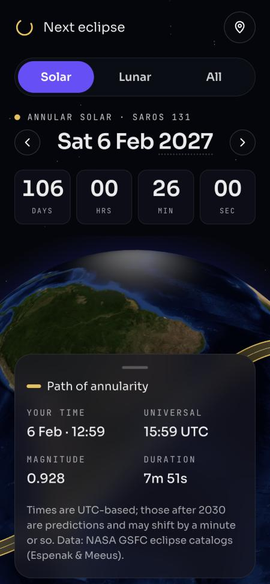 | 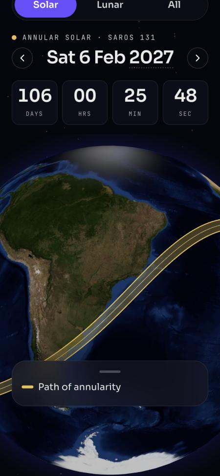 |

The globe window between the countdown and the sheet is about 160 px tall. The camera centres the path behind the sheet, so only the gold edges show. Folding the sheet reveals a good map, but the sheet starts open and you can only fold it by tapping the small handle.
*Proposal:* start the sheet as a peek (legend plus one key fact), let users drag it open, and move the camera target up so the path sits in the visible window.

**F2 · Mobile: no "where is it visible" sentence**
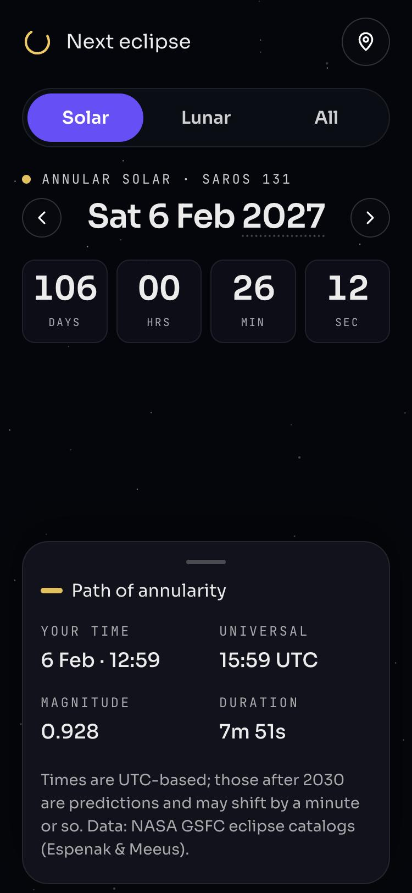
Desktop says "The path of annularity crosses South America and Africa…". Mobile drops that sentence, and the globe isn't there yet either, so for about 10 s nothing on screen answers "where?".
*Proposal:* show the description on mobile, clamped to two lines, under the date.

**F3 · Mobile: content overflows a container that can't scroll; the header can get stuck off-screen**
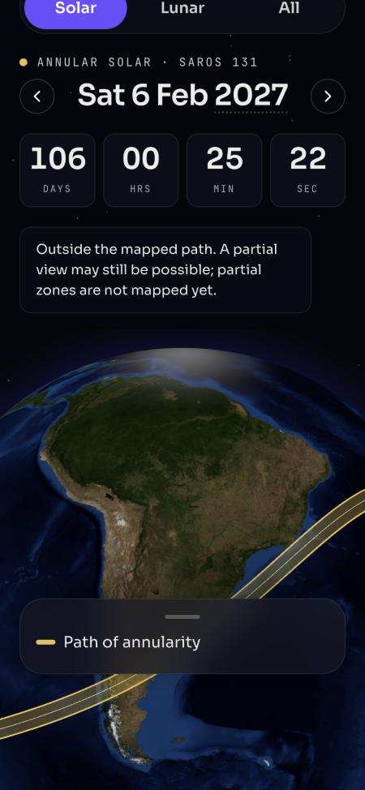
The mobile root uses `overflow: hidden`, and its content is taller than the screen once the location answer, the "Back to next" pill or a wrapped date appear. Focusing a control scrolled that container 99 px, and users can't scroll it back: the logo and location button were unreachable, and the bottom of the sheet was clipped.
*Proposal:* lay out mobile as fixed regions (header · question block · globe · sheet) that always fit the screen, or let the page scroll normally. Never use `overflow: hidden` on a container that can end up scrolled.

**F4 · The location answer is vague and detached from the content**

| Desktop answer | "You" marker (zoomed) |
|---|---|
| 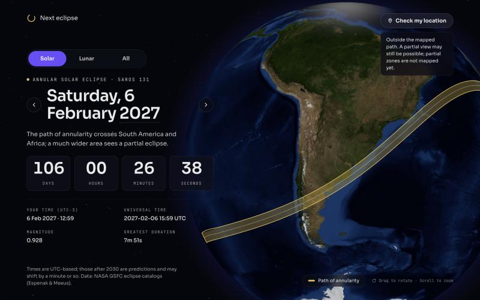 | 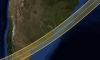 |

From Buenos Aires the answer is "Outside the mapped path. A partial view may still be possible…". Yet the path edge is only about 180 km away, a few hours' drive. On desktop the answer is a small bubble in the top-right corner, far from the headline it relates to. The marker is a faint expanding ring that's easy to miss.
*Proposal:*
- an answer card next to the headline:
  - a verdict: in the path / near it / partial only / not visible
  - the distance and direction to the path ("180 km south-east")
  - for lunar eclipses, how much of the eclipse is visible
- a solid pin with a "You" label
- an answer that updates as you step through eclipses (it already does, but out of view)

**F5 · The countdown target doesn't match the times shown**
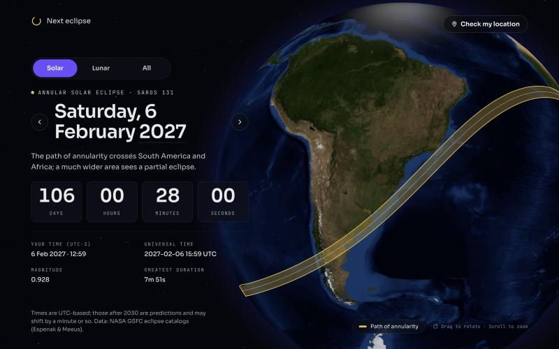
Since #6 the tiles count to the eclipse's *start*. For solar eclipses that's the peak minus 2.5 h, an approximation. The fields underneath show only the *peak* time, and nothing on the tiles says what they count to. A user comparing them sees a 2.5 h gap with no explanation.
*Proposal:* label the countdown ("Starts in" / "Peak in"), and show start · peak · end as a small timeline under the date. Design decision: should solar eclipses count to the peak instead, since their start is an approximation?

### Medium

**F6 · The globe takes 7–10 s to appear, with no loading state**
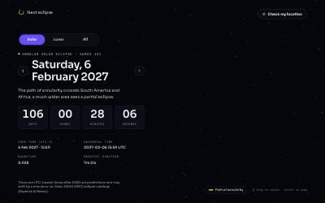
The 1.4 MB Earth texture isn't requested until about 7.3 s after page load, once the globe code has started up. Until then the right half of the desktop page, and the middle of the mobile one, is empty starfield.
*Proposal:* a designed placeholder (a dim sphere silhouette with the eclipse colour, or a static low-res Earth image), plus preloading a smaller texture (≈300 KB WebP).

**F7 · The lunar map is hard to read**
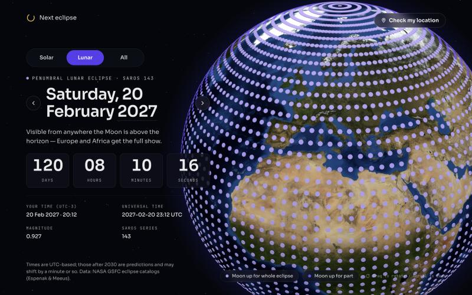
- "Moon up for the whole eclipse" and "for part of it" are two close purples (`#b8a6ff` / `#7c5cff`).
- Dots cover the whole visible side, hiding the land.
- At the pole the grid bunches into concentric rings, because points are spaced by latitude and longitude.

*Proposal:*
- shade the regions instead of drawing dots (or use much sparser dots)
- show "whole" vs "part" with strong contrast: bright vs hollow, or bright vs a hatched band
- use an equal-area grid if dots stay

**F8 · On type switch, the camera moves seconds after the new overlay appears**
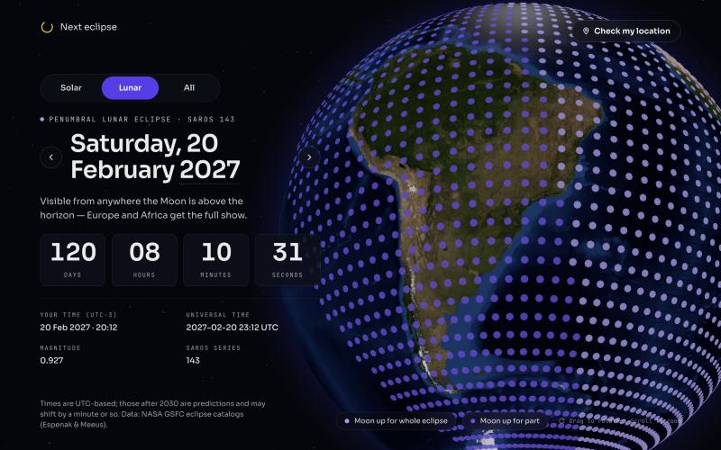
The lunar dots appear over South America first, and the camera reaches Europe and Africa a few seconds later.
*Proposal:* fly first and fade the overlay in at the end, or cross-fade both.

**F9 · Desktop headline: awkward date break and a ragged left edge**

"Saturday, 6 / February 2027" splits the date in the middle. The arrows sit outside the text column, so the date is indented compared with the eyebrow, description and tiles.
*Proposal:* put the weekday on its own small line and make "6 February 2027" the large line, so it never breaks mid-date. Put the arrows in a nav row (‹ year ›) or at fixed positions aligned with the column edges.

**F10 · Mobile: the date wraps and the layout jumps while browsing**
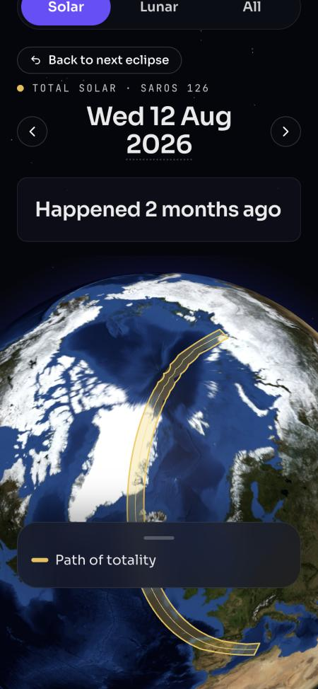
At 375 px "Wed 12 Aug 2026" wraps onto two lines. Together with the "Back to next eclipse" pill appearing, everything below shifts on each step, including the arrows under your thumb.
*Proposal:* fixed-height slots for the pill and the date line, and text fitted to one line (or a smaller size).

**F11 · No sense of where you are in time**
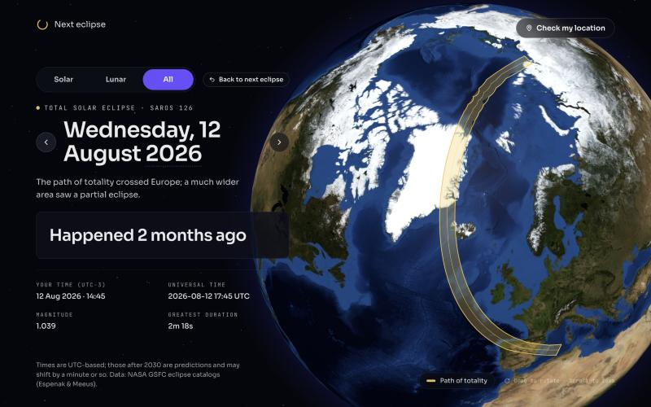
The arrows only show their target in a hover tooltip. Nothing says "past" except the countdown sentence, and nothing shows how far you are from now or how many eclipses there are.
*Proposal:*
- a slim timeline under the headline with a "now" marker and the current position (it doubles as a scrubber later)
- a Past / Upcoming / Happening chip in the eyebrow
- the target date shown on the arrows on desktop

**F12 · Past and far-future states waste their space**
Same screenshot: a full-width card holding just "Happened 2 months ago".
*Proposal:* a lighter treatment for the sentence, and use the space for a useful next step: "Next total solar eclipse: 2 Aug 2027 →", or the next eclipse in the same Saros series.

### Low

**F13 · "Next eclipse" branding while viewing the past.** The site name is fine, but the page never says you're off the live view, apart from the pill. Covered by the F11 chip.

**F14 · The "Drag to rotate · Scroll to zoom" hint can't be read over the globe**

*Proposal:* give it the same glass pill as the legend, or hide it after the first drag.

**F15 · Laptop height: details and footnote fall below the fold**
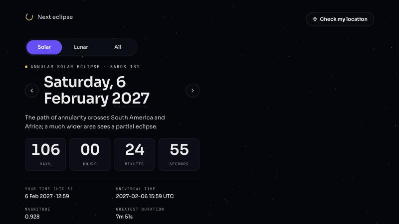
At 1280×720 the page is 852 px tall, and the legend and footnote need a scroll.
*Proposal:* a more compact vertical rhythm below 800 px of height (smaller date, details in two columns next to the countdown, or tucked away).

**F16 · The year picker is hard to discover, and its options leak into page text.** Only a dotted underline shows it's tappable. Copy-paste and reader views include all 100 years.
*Proposal:* add a visible chevron, and later a decade grid. Hide the native options from page text (for example, render the select only on focus).

## Design brief

### Goal
Someone landing on the page answers **when, where and can I see it** within 3 seconds, on any screen. Browsing through time feels like moving along a timeline, not paging through a form.

### Principles
- **The globe is the answer to "where".** Never cover it by default, and never leave it blank.
- **One answer per question, near the question.** Countdown with its target, description under the date, location verdict next to both.
- **Stable layout.** Stepping through eclipses changes content, not positions.
- **Night-sky identity stays:** dark only, Sora + JetBrains Mono, gold `#f5c84c` for solar, violet `accent.*` / `lunar.*` for lunar, glass surfaces.

### Frames to design
| Frame | Sizes | States |
|---|---|---|
| Landing, solar | 1440×900, 1280×720, 375×812 | upcoming ≤ 1 y (tiles); globe loading; globe ready |
| Landing, lunar | same | whole / part / not visible zones |
| Location answer | desktop + mobile | in path · near path (distance + direction) · partial only · not visible · location denied |
| Browsing | desktop + mobile | past · happening now · far future (> 1 y) · first/last eclipse (arrow disabled) |
| Timeline / position indicator | desktop + mobile | live (at now) · pinned in past · pinned in future |
| Mobile sheet | 375×812 | peek · expanded |
| Partial solar (no map) and non-central | desktop + mobile | message instead of path |

### Data available to the design (no new data needed unless noted)
Per eclipse:
- type, kind, Saros
- start, peak and end times (UTC; the solar start/end is ±2.5 h around the peak)
- magnitude, central duration
- visibility geometry (solar path polygon + centre line; lunar 3° grid with whole/part zones)
- a one-line region description

The catalog spans 452 eclipses, 2001–2100. Distance to the path (F4) can be computed in the browser from the existing geometry. The percentage of the Sun covered for partial viewers would need new data.

### Proposed order
1. **Fix now (no design needed):**
   - F3 layout trap
   - F10 date wrap
   - F2 description on mobile
   - F14 hint legibility
2. **Design pass:**
   - F1 mobile sheet + globe window
   - F4 location answer card
   - F5 countdown label + event timeline
   - F9 headline typography
   - F11 timeline / position
   - F7 lunar visual
3. **Then:**
   - F6 loading placeholder + texture size
   - F8 camera choreography
   - F12 richer past and future states
   - F15 short-height layout
   - F16 year picker affordance

### Questions for the design pass
- Should the countdown target the start or the peak, especially for solar eclipses, whose start is approximate?
- Is a timeline strip worth its space on mobile, or should mobile get only a Past/Upcoming chip plus the arrows?
- Should the lunar map move from dots to shaded regions? That needs a rendering change (polygons from the grid) but no new data.
- Should the location answer give a distance for lunar eclipses ("Moon rises 40 min into the eclipse") or only a verdict?

## Design decisions
Agreed on 2026-10-23 from the frames on the design canvas (https://claude.ai/artifact/QzmrJk3aBdsNA117xTzarn, private to the owner). The canvas draws the globe as a simple illustration. Distances, the in-path duration and the moonrise time in it are placeholders. Dates, Saros numbers, magnitudes, durations and times come from the catalog.

### Answers to the open questions
1. **Countdown target:** solar eclipses count to the **peak** ("Peak in"), because their start is a ±2.5 h estimate. Lunar eclipses count to the **start** ("Begins in"), because their contact times are exact. The label always names the target.
2. **Mobile timeline:** yes, a slim strip (about 22 px) under the description, plus the status chip.
3. **Lunar map:** shaded regions replace the dots. "Moon up the whole time" is a solid fill with a light outline; "for part of it" is a hatched fill. They differ in pattern and lightness, not only hue.
4. **Lunar location answer:** a verdict (the whole eclipse / part of it / not visible) plus, for "part of it", when the Moon rises or sets during the eclipse, with a bar showing the share you can see. This needs the Moon's altitude at the user's location, which the grid doesn't hold (see the build plan).

### Layout
- **Desktop headline (F9):** eyebrow (kind · Saros · status chip), then the weekday on its own small line, then "6 February 2027" as one large line that never wraps. The year keeps the dotted underline and gains a chevron (F16).
- **Nav row (F11):** ‹ previous-date · timeline strip · next-date ›, aligned with the text column. The arrows show their target date on desktop and are icon-only on mobile.
- **Status chip (F11, F13):** Upcoming / Happening now / Past. On mobile, off the live view, the chip becomes the "Past ↩ Now" button in the same slot, so nothing moves. Its tap area is 44 px even though it's drawn smaller.
- **Timeline strip:** shows about 18 months either side of the selected eclipse. A dot per eclipse of the current filter, a large dot for the selected one, a white "now" line, and the span between now and the selection highlighted. When now is outside the window, an edge marker says how far ("Now · 18 years back"). At the ends of the catalog, a stop line and a disabled arrow.
- **Countdown (F5):** the label above the tiles names the target. Under the tiles, a start · peak · end line in the user's time zone. The solar start and end are marked "~". "Happening now" shows a progress bar from start to end, with the peak marked. More than a year away, a sentence ("In 17 years, 10 months") in a box the same height as the tiles.
- **Details row:** universal time, magnitude, and central duration ("Longest ring" / "Longest totality"). The user's local time moves into the start · peak · end line.
- **Past state (F12):** a lighter "Happened 2 months ago", then two links where the tiles were: the next eclipse of the same kind, and the next one in the same Saros series.

### Location answer (F4)
- **Desktop:** a card beside the headline, over the globe's edge, joined to the pin by a thin line. On mobile, the answer replaces the content of the sheet peek.
- **Solar verdicts:**
  - **In the path:** distance to the centre line.
  - **Near the path:** distance and compass direction to the path's edge ("180 km south-east"), plus "partial from here".
  - **Partial only:** the distance to the path, in passing.
  - **Not visible:** a link to the next eclipse visible from here.
  - **Location blocked:** how to allow location, and a "Try again" button.
- **"Near" threshold:** 500 km from the path edge. Tune it during the build.
- **No local in-path duration:** the "4m 10s" on the canvas would need new data (local contact times), so the card shows only the distance to the centre line.
- **Marker:** a solid white pin with a "You" label replaces the faint ring. When the user is near the path, a dashed line to the nearest edge carries the distance.
- **Header button:** shows the coordinates once location is on ("34.6°S 58.4°W · Change"). There's no reverse geocoding, so no place names.

### Mobile (F1, F2, F3, F10)
- **Fixed regions that always fit the screen:** header · type toggle · question block (fixed height, each line in a fixed slot) · globe window · sheet. No container uses `overflow: hidden` while it can scroll.
- **Question block:**
  - the eyebrow with the chip
  - the date row: ‹ weekday over "6 Feb 2027" ›, on one line at 28 px
  - the description, clamped to two lines
  - the timeline strip
  - the countdown label (with the peak time) above 64 px tiles
- **Sheet:** it starts as a peek (about 92 px) holding the legend, one key fact and the start · peak · end times, or the location answer once asked. Dragging it up snaps it below the date row, so the question stays readable. The camera target moves up so the path sits in the visible globe window.

## Build plan
Small PRs, each green before merging. Every piece of logic goes in a pure function with tests (there is no React testing library). The order follows dependencies. 2–4 can be built in parallel once 1 is in; 5 comes before 6.

| # | PR | Findings | Logic to test first | Main files |
|---|---|---|---|---|
| 1 | **Quick fixes:** mobile layout without the overflow trap; one-line mobile date; mobile description (2 lines); hint in a glass pill | F3, F10, F2, F14 | date fitting for the short format | `App.tsx`, `EclipseHeadline.tsx`, `format.ts` |
| 2 | **Headline and nav row:** weekday line, large date, arrows with target dates, status chip (mobile chip as "↩ Now"), year chevron | F9, F11 (chip), F13, F16 (chevron) | `statusOf(phase, isLive)` → chip label and action | `EclipseHeadline.tsx`, `App.tsx` |
| 3 | **Countdown target and event line:** "Peak in" / "Begins in", start · peak · end line, happening-now progress, more-than-a-year sentence | F5 | `countdownTarget(eclipse)`, `eventProgress(eclipse, now)` | `hooks/countdown.ts`, `Countdown.tsx` |
| 4 | **Timeline strip,** desktop and mobile | F11 | `timelineWindow(eclipses, selected, now)` → dot positions, now marker or edge label, catalog edges | new `TimelineStrip.tsx`, `hooks/timeline.ts` |
| 5 | **Location logic:** distance and compass direction to the path edge and centre line; verdicts with the 500 km threshold | F4 | `distanceToPath(geometry, point)`, `bearingLabel(deg)`, `locationVerdict(...)` | `globe/visibility.ts`, `YourLocation.tsx` |
| 6 | **Location answer UI:** desktop card and connector line, solid "You" pin with the distance line, mobile peek answer, blocked state, coordinates in the header button | F4 | copy per verdict (extends `locationMessage`) | `YourLocation.tsx`, `EclipseGlobe.tsx`, `globe/layers.ts` |
| 7 | **Mobile sheet and globe window:** peek and expanded snap points, drag, camera target offset | F1, F3 (fixed regions) | `snapPoint(dragY, velocity)` | `MobileSheet.tsx`, `App.tsx`, `EclipseGlobe.tsx` |
| 8 | **Lunar shaded regions:** polygons from the 3° grid, solid vs hatched, new legend swatches | F7 | `gridToPolygons(grid)` (merge cells per zone) | `data/grid.ts`, `globe/layers.ts`, `Legend.tsx` |
| 9 | **Past and far-future next steps:** next eclipse of the same kind and the next in the same Saros | F12 | `nextOfKind(...)`, `nextInSaros(...)` | `data/repository.ts`, `Countdown.tsx` |

**Open dependency, lunar moonrise (decision 4):** the "Moon rises 1 h 50 min in" line needs the Moon's altitude at the user's location over the eclipse. That means a small ephemeris: either a library such as `astronomy-engine` or a compact lunar position formula. Until it's decided, PR 6 ships the lunar verdict and the bar without the moonrise time.

**After these** (from "Proposed order", step 3): F6 loading placeholder and smaller texture, F8 camera choreography, F15 short-height layout, and the F16 decade grid.

## Out of scope
New eclipse data (partial-solar zones, local contact times), accounts or notifications, light mode.

## Changes during implementation

### Order
- **PR 7 (mobile sheet) was built before PRs 5 and 6.** Each of PRs 1–4 made the mobile headline taller, so the globe window kept shrinking; the sheet's peek gave that room back first.

| Build PR | Merged as |
|---|---|
| 1 Quick fixes | #8 |
| 2 Headline and nav row | #9 |
| 3 Countdown target and event line | #10 |
| 4 Timeline strip | #11 |
| 7 Mobile sheet and globe window | #12 |
| 5 Location logic | #13 |
| 6 Location answer UI | #14 |
| 8 Lunar shaded regions | #15 |
| 9 Past and far-future next steps | #16 |

### Location answer
- **No moonrise line yet.** Lunar answers show the verdict and the "Moon up start to end / for part of it / below your horizon" title only. Choosing an ephemeris (`astronomy-engine` or a compact formula) is still open.
- **"Partial only" and "not visible" became one solar verdict, "far from the path".** Without partial-zone data the app can't tell them apart. The card gives the distance and direction, and says a partial eclipse "may still be visible".
- **Distances are great-circle**, point to segment, against the path's edge and centre line. A flat-map version drifted at continental distances. From Buenos Aires, the 6 Feb 2027 path is 181 km south-east.
- **No connector line from the desktop card to the pin.** The pin is drawn inside the globe and the card outside it. Instead, a dashed line runs from the pin to the nearest point of the path when you're near it. At the default zoom it is only a few pixels long.

### Countdown and headline
- **Past label is "Ended"**, and the far-off sentence drops "In" ("17 years, 10 months").
- **The past and far-off sentence loses its box on desktop only.** Phones keep the box, so the text stays readable over the globe behind it and stays in the same slot.
- **Details are one row of three facts:** universal time (time only, since the date is in the headline), magnitude, and duration or Saros. Your local time moved into the event line.
- **Desktop content padding went from 40 to 24 px** so 1440×900 still fits with the event line.
- **Desktop keeps the "Back to next eclipse" pill** beside the type toggle. The "Past ↩ Now" chip button is phones only.

### Mobile
- **The peek's key fact is the central duration only.** Lunar peeks have none, so their two-item legend stays on one line.
- **Once location is checked, the answer card replaces the peek.** The legend and times move into the open sheet.
- **At least 140 px of the globe always shows above the peek.** On short phones (375×667) the page scrolls a little instead.
- **The globe reaches up behind the countdown tiles.** The tiles' 82% background keeps them readable.

### Lunar map
- **The zones are painted onto one texture, not drawn as polygons.** Translucent row rectangles overlapped at their seams and showed as stripes. One equirectangular canvas draped over the globe as a single tile has no seams and can carry real hatching. "Whole" is a solid tint and "part" is a fainter tint with diagonal hatching. There's no outline on the whole zone, and edges follow the 3° grid in steps.
- **Legend:** "Moon up the whole time" (solid swatch) and "For part of it" (hatched swatch).
- **`three` is imported directly** for the texture. `src/three.d.ts` declares it untyped, because `@types/three` needs TypeScript 5 and the repo is on 4.9.

### Timeline and next steps
- **The timeline strip is hidden from screen readers.** The arrows' labels and the status chip carry the same information. It redraws once a minute, not every second.
- **Next steps stay within the current filter's type.** The Saros step follows the series, so it can point to a partial eclipse.

### Known issues
- A thin dark arc near the globe's edge on some lunar eclipses (seen on 6 Jul 2028), possibly the texture's seam at ±180°. Not yet explained.
- Not checked: how the "You" pin behaves when the globe is rotated so the viewer is on the far side.

### Not built yet
From "Proposed order", step 3: F6 (loading placeholder and smaller texture), F8 (camera choreography), F15 (short-height layout) and the F16 decade grid. The year chevron from F16 shipped in #9.
